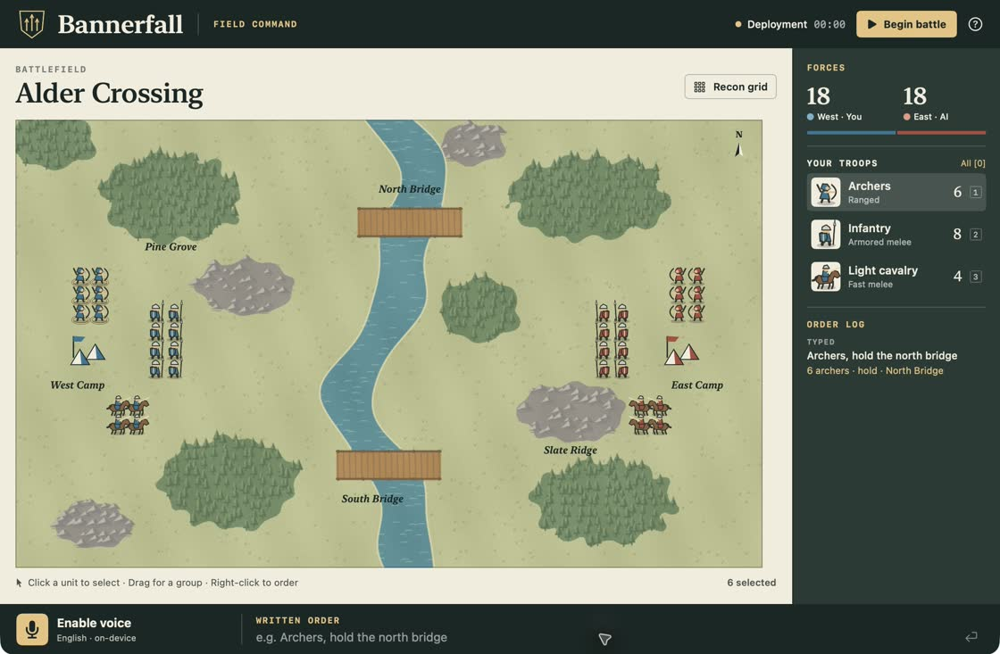

# Bannerfall

A single-player, voice-controlled 2D RTS for macOS. Lead the blue western army across Alder Crossing. The red army advances on its own. Each side fields six archers, eight armored infantry, and four light cavalry. Eliminate the opposing army to win.



## Play on a Mac

Download the Apple Silicon app from [Releases](https://github.com/kargo-kult-wahrheit/voice-rts/releases). Unzip it and open **Bannerfall**. The app includes its English speech model and runs offline. The minimum macOS version is 14. This prototype is locally signed and has not been notarized by Apple. If your Mac blocks a downloaded build, the source build below produces a native executable on your Mac.

1. Click **Enable voice** and grant microphone access. Wait for **Ready**.
2. Hold **Space**, say “Archers, hold the north bridge,” and release. The order log shows the transcript, recipients, and destination. You can also type in **Written order** and press Return.
3. Click **Begin battle**. You can stage orders before the battle and give new ones throughout it.
4. Press **V** to see the terrain the units recognized and the paths your selected troops plan to take.

### Orders

| Say | What happens |
| --- | --- |
| “Archers, hold the north bridge” | The archers take positions around the crossing and defend them. |
| “Infantry, move to Pine Grove” | The infantry march to the trees and hold on arrival. |
| “Cavalry, attack enemy archers” | The riders prioritize opposing archers, switching to other enemies once the archers fall. |
| “All units, fall back to camp” | Survivors break contact and regroup in formation at West Camp. |
| “Go there” | The selected units move to the last ground location you clicked. |

Give one order at a time. Name a troop type, say “all units,” or leave the subject out to address your selection. Named destinations include both bridges, Pine Grove, Slate Ridge, West Bank, West Camp, and East Camp. The command model also recognizes common alternatives such as “bowmen,” “horsemen,” “stand your ground,” and “withdraw.”

### Controls

| Input | Action |
| --- | --- |
| Hold Space or the microphone control | Push to talk after enabling voice |
| Return / Escape | Focus the order field / leave it |
| 0 / 1 / 2 / 3 | Select all / archers / infantry / cavalry |
| Click or drag on friendly troops | Select one unit or a group. Shift adds to the selection |
| Click ground / right-click ground | Mark a location / move selected troops |
| Right-click an enemy | Focus that individual opponent |
| P / V | Begin, pause, or resume / show terrain and routes |

### Playtest logs

Bannerfall saves one JSON Lines file per launch in `~/Library/Logs/Bannerfall/`. Click **Show logs** in the order log to reveal the current file in Finder. You can read it during play or after quitting. Restarting the battle starts a new match number in the same file.

Each order records its source, text, selection, map pin, positions of living units, parsed order, and the orders assigned to individual units. Voice entries include Whisper’s first transcript, any grammar retry, which wording reached the interpreter, and recording and decoding times. Failed and cancelled attempts include a reason. A classifier confidence score applies only to the action it chose. Use the flag beside an order to mark a transcription error, a misunderstood order, or unexpected unit behavior. The flag links to that order in the file.

Logs stay on your Mac. Microphone audio is temporary and is deleted after processing or cancellation.

## Build from source

Install Apple’s Command Line Tools (`xcode-select --install`) on macOS 14 or later. From a checkout run:

```sh
make run
```

The first build downloads the pinned whisper.cpp source and quantized English Base model, verifies both SHA-256 hashes, compiles the CPU decoder with Apple Clang, and statically links it into `build/Bannerfall.app` for the current Mac architecture. Subsequent builds reuse the cached files. No API key, Python environment, or game server is needed.

```sh
make test        # language, terrain recognition, routing, formations, complete match, reset
make audio-test  # four synthetic English recordings through the shipped decoder and order system
```

## How it works

- **Speech.** Push-to-talk captures a short, mono 16 kHz recording. whisper.cpp runs Base English Q5_1 on four CPU threads, with the model kept in memory between orders. The audio is deleted after decoding or cancellation.
- **Understanding.** A multinomial naive Bayes classifier learns four intents from the bundled labeled examples in `Resources/orders.json`. A separate resolver maps troop names and destinations to live units and map positions. When an unclear transcript resembles an order, Whisper makes a second pass using a field-order grammar. The game accepts the correction only if the text remains similar and the command parses. Typed and spoken orders use the same interpreter.
- **Terrain.** The renderer paints one static map. A local color classifier samples 25 pixels per cell from that finished terrain image to reconstruct a 40 × 24 navigation grid. Water and rock block movement, forest slows travel, and the two bridges connect the banks. The recon view displays the grid.
- **Units.** Each soldier has its own attack range, movement speed, health, orders and weighted A* route. Groups receive distinct formation slots. Rocks block archers’ shots, infantry absorb more arrow damage, and cavalry gain a damage bonus against archers. Combat advances at a fixed 30 ticks per second.

Third-party notices for the redistributed runtime and model are in [Resources/ThirdParty.txt](Resources/ThirdParty.txt). The short audio fixtures were synthesized with meSpeak for the regression tests.
